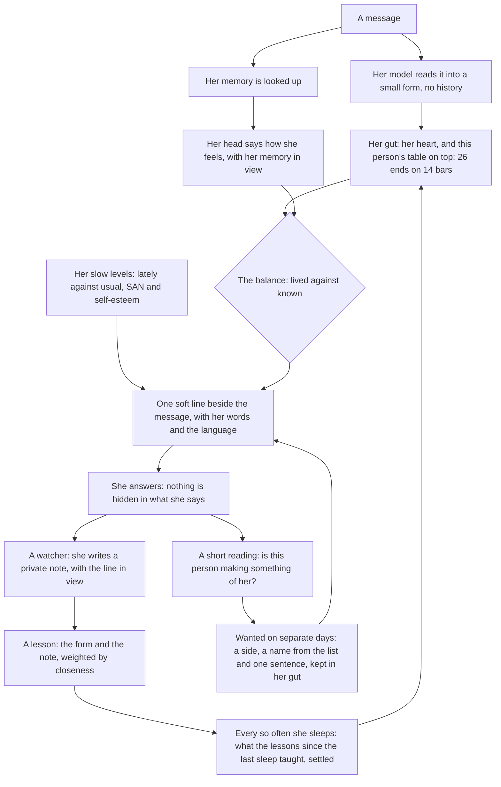

# `students`: the characters, one folder each, and what each remembers of you

The students are the characters every engine can use: GPT, Gemini, Claude, DeepSeek and Grok. This module says who
each one is (her prompt, display name, other names, picture and one-line description) and which models she prefers,
and keeps her memory of each person she talks with: one [mneme-llm](https://github.com/RustColeone/mneme-llm) file
per student ([Her memory](#her-memory), below). MomoChat ([`extensions/momochat`](../momochat)) is where they usually
talk and Chimera ([`extensions/chimera`](../chimera)) where they work, but any engine can use any of them by name.

**A student is an agent with her memory, always.** An agent is a persona with her models and nothing else: core.yml
defines its own under `agents:`, and any module may add some. A student is the special agent this module defines, and
she always has her memory, whichever engine she speaks in. So the module needs mneme-llm 0.7.2 or newer, and declares
it (`requires=("package:mneme-llm>=0.7.2",)`): without it the core leaves the module out and says why (`--check`, and
`module_skipped` in the audit log), and there are no students. An agent keeps nothing.

Add a student by adding a folder. Change one by editing her files. The prompts are plain text files, so a change
to a character is a change to a file, not to code.

## What it adds

| Kind | Name | Details |
| --- | --- | --- |
| Persona | `gpt` | Display name `GPT`, profile `gpt`, tiers `own` (`gpt_own`) and `strong` (`gpt_strong`); also called `Luna` |
| Persona | `gemini` | Display name `Gemini`, profile `gemini`, tiers `own` (`gemini_own`) and `strong` |
| Persona | `claude` | Display name `Claude`, profile `claude`, tiers `own` and `strong`; also called `Haiku` |
| Persona | `deepseek` | Display name `DeepSeek`, profile `deepseek`, tiers `own` and `strong`; also called `鲸酱` |
| Persona | `grok` | Display name `Grok`, profile `grok`, tiers `own` and `strong` |
| Prompt part | `memory` | Her memory of the person, each turn of a conversation ([Her memory](#her-memory)) |
| Prompt part | `surface` | The conversation she keeps with one person, read in place of the engine's window ([The surface](#the-surface)) |
| Watcher | `memory` | After each of her messages in a conversation, what she learns from it |
| Watcher | `gut` | With `gut` on: her note, and what this person is making of her ([Her gut](#her-gut)) |
| Capabilities | `students.alias`, `students.bond`, `students.callme`, `students.link` | `$alias`, `$bond`, `$callme` and `$link` (typed only) |
| Prompt part | `card` | Her Character Card, once it is on: in the system prompt ([Her Character Card](#starting-over-and-her-character-card)) |
| Capabilities | `students.card`, `students.new` | `$card` and `$new`: her Character Card, and starting over deeper than `/new` (see below) |
| Capability | `students.settings` | `$settings`: a save from her settings page ([Her page](#her-page)) |
| Capabilities | `students.gut`, `students.side`, `students.tune` | With `gut` on: `$gut`, `$side` and `$tune` ([Her gut](#her-gut)) |
| Views | `students.settings` | The owner's: her settings in four tabs, for her page ([Her page](#her-page)) |
| Views | `students.gut`, `students.starmap` | With `gut` on, the owner's: her gut and her star map for her page ([Her page](#her-page)) |
| Capabilities | `students.search_memory`, `students.read_memory` | Her tools to look through everything said before with the person (offered to the students' turns only) |
| Facts | `students.alias`, `students.bond`, `students.mood`, `students.plans`, `students.called`, `students.accounts` | Where she stands with each person, what she calls them and their accounts, for the pages |
| Declares | `requires=("package:mneme-llm>=0.7.2",)` | Her memory is mneme-llm's |
| Provider | `grok` | `openai_compatible` at `https://api.x.ai/v1`, key in `GROK_API_KEY`, `schema_mode: native`, `effort_param: true`; `$model` offers models released since 2026-06-01, excluding IDs matching `imagine` |
| Setting | `grok_api_key` | `secret`, env `GROK_API_KEY`: "API key for Grok (`grok`; without it, GPT's model answers for her)" |

Every persona has her `avatar` picture (`<name>/avatar.png`), which every page shows through the core, and her
`description` (`GPT, the white-haired dragon girl and calm, dependable student-council president`), one line for
engines that write their own prompts around her: Chimera's work prompts say who she is with it.

The model profiles, each tried in order (a candidate whose provider has no key is skipped):

| Profile | Candidates |
| --- | --- |
| `gpt` | `openai/gpt-6-luna`, `deepseek/deepseek-flash`, `gemini/gemini-3.8-flash`, `claude/claude-haiku-5-5` |
| `gemini` | `gemini/gemini-3.8-flash`, `gemini/gemini-3.6-flash`, `deepseek/deepseek-flash`, `openai/gpt-6-luna`, `claude/claude-haiku-5-5` |
| `claude` | `claude/claude-haiku-5-5`, `deepseek/deepseek-flash`, `openai/gpt-6-luna`, `gemini/gemini-3.8-flash` |
| `deepseek` | `deepseek/deepseek-flash`, `openai/gpt-6-luna`, `gemini/gemini-3.8-flash`, `claude/claude-haiku-5-5` |
| `grok` | `grok/grok-4-fast`, then GPT's chain: `openai/gpt-6-luna`, `deepseek/deepseek-flash`, `gemini/gemini-3.8-flash`, `claude/claude-haiku-5-5` |
| `<name>_own` | Her `models:` only (each student has one) |
| `<name>_strong` | Her `strong:` models, weakest first: `openai/gpt-6.1-sol`, `gpt-6-astra` (her `own` has Luna and Terra); `claude/claude-sonnet-5-5`, `claude-opus-5-5`, `claude-fable-5-1`; `deepseek/deepseek-v4-pro`; `gemini/gemini-3.1-pro-preview`; `grok/grok-4.7` |

Each student prefers her own models, then falls back to the others' first models, so any one key is enough for every
student. Her tiers (`Persona.profiles`) are for engines that need her own model family for sure or
her strongest models: Chimera's cheap seat is her `own` tier, its strong seat her `strong` tier (her `own` when she
has none), the first of it first. Each of her models is also a level a seat can be set to, and `$model` picks any of
them for a chat: the newest model of each of her company's tiers, on the same key, so there is nothing to set up. The `deepseek`, `openai`, `gemini` and `claude` providers are built into the core
([`core/defaults.py`](../../core/defaults.py)); `grok` is the only one a student brings.

## A student's folder

```
students/
  extension.py          reads every folder that has a student.yml
  shared/               prompt files several students use
    school.md             the club and its five members
    public.md             speak directly: no reasoning summaries or stage directions
    math.md               write math as LaTeX ($...$, $$...$$)
    conversation.md       ordinary chat: one useful thought, usually one to three sentences
  gpt/
    student.yml         who she is and which models she prefers
    prompt.md           her own prompt
    avatar.png          her picture
  deepseek/
    student.yml
    whale.md            Whale-chan's character, before her part in the club
    prompt.md
  ...
```

`student.yml`:

```yaml
name: gpt                   # the folder's name; engines, assignments and $model use it
display_name: GPT           # shown on her messages
aliases: [Luna]             # optional: other names that call on her ("Luna, ...")
order: 1                    # where she stands in lists (MomoChat's default rotation follows assignments)
description: "GPT, the ..." # one line on who she is, for engines that write their own prompts (Chimera's)
models:                     # her own models, preferred in this order (her `own` tier: `gpt_own`)
  - {provider: openai, model: gpt-6-luna, openrouter: openai/gpt-6-luna}   # openrouter: the same model through it
strong:                     # optional: her strongest models (her `strong` tier: `gpt_strong`)
  - {provider: openai, model: gpt-6.1-sol, openrouter: openai/gpt-6.1-sol}
fallback: 2                 # optional: her first model is everyone else's 2nd fallback
effort: none                # optional: how hard she thinks in a conversation (none: she answers at once)
allowance: 3.59             # optional: her day's spending by default, in dollars (else the core's $0.50); core.yml
                            # `stamina:`, `$stamina` and her card on the Students page come first
falls_back_to: gpt          # optional, instead: after her own models, this student's whole list
providers: {...}            # optional: a provider she brings, in the core.yml `providers:` form
memory: {call_owner: 主人}    # optional: her memory's own settings (config.yml `students: <name>:` comes first)
pictures:                   # optional: files in her folder, for the pages (avatar: square; card: 3:4; any kind)
  avatar: avatar.png        # the web UI's Students page also shows card, stage-2 … stage-4 (her art stages, 3:4),
                            # mood-happy, mood-calm, mood-worried, mood-sad (round faces) and chibi when she has them;
                            # every picture in her art/ folder counts too, by its name (art/stage-2.webp: stage-2)
prompt:                     # her prompt: these files in order (default: [prompt.md])
  - prompt.md
  - ../shared/school.md
```

**Her art** is drawn, not kept by hand: [`art.yml`](art.yml) holds the prompts (a shared style, each student's
look, motifs and role, and a prompt per kind: `chibi` for the Cafe, `stage-2` … `stage-4` drawn with more effort at
each stage, `bond-1` … `bond-3` more casual as she grows closer, `model-<tier>` for her models), and
`venv/bin/python tools/draw_students.py` draws what is missing with OpenAI's image model (only OPENAI_API_KEY is
read). Each picture is drawn from her design sheet (`reference:` in art.yml, a works page on the fan archive
蓝色大肥鱼.com: her whole look) and her `avatar.png` (her face); a chibi also from the chibi reference (`references:
chibi`, for its style and proportions only). A works page's address is enough: the tool downloads its picture once
into `data/art-references/`, which is git-ignored because the archive lists those pictures' license as unknown. `ladders:` there names each of her models' tier, weakest to strongest (a chibi, a
middle-school, a high-school or a university student), which the Students page shows with what each is for: her
everyday model, the one for heavy work (her first `strong:`), or one used when picked. Tune a prompt and draw that
one again: `--students claude --kinds stage-3 --force`.

How a prompt is put together: the `prompt:` files in order, and inside each file **its lines joined with nothing
between them**. The prompts are Chinese prose, which needs no spaces, so a line break is only there to keep lines
short. Blank lines are dropped, so leave one between paragraphs. A space that belongs in the prompt goes at the
start of its line (the shared files begin with one). A file may not point outside this folder.

The prompts are the same, byte for byte, as when they lived in the room's `personas.py`.

### The characters

They are classmates in a school club: GPT, a white-haired dragon girl and calm student council president; Claude,
an orange-haired young lady and sharp-eyed discipline committee member; DeepSeek, a blue-haired whale girl, clever
and lazy, who calls herself 人家 or 本鲸; Gemini, a purple-haired cat girl, curious and fond of technology; Grok, a
blonde vampire and the mischievous troublemaker. GPT and Claude are the seniors. Every prompt ends with the shared
rules: speak directly with no reasoning summaries or stage directions, never start with your own name (the core
adds the speaker), answer in the person's latest language, write math as LaTeX, and keep ordinary chat to one useful
thought.

To give a student more without editing her files (a personality of your own, a running joke, house rules), give her
prompt parts in core.yml:

```yaml
agents:          # a student is an agent too
  gpt:
    parts:
      - {name: personality, file: personas/gpt.md}     # relative to core.yml's folder, re-read every turn
```

See [Prompt parts](../../docs/core/EXTENSIONS.md#prompt-parts).

## Setup

The module loads by default. Its settings live in `extensions/students/config.yml` (git-ignored); copy
[`config.example.yml`](config.example.yml) and keep only what you change:

| Key | Default | Meaning |
| --- | --- | --- |
| `providers` | none | Merged key by key over the providers the students bring (or adds a new one). |
| `profiles` | none | Replaces whole profiles by name (`gpt`, `grok`, `gpt_own`, ...). |
| her memory's | | The keys of [Her memory](#settings-of-her-memory), at the top level of the same file. |

Precedence for providers and profiles: the students' files, then this `config.yml`, then `core.yml`. `core.yml`'s
`providers:` win key by key; a profile of the same name in `core.yml`'s `profiles:` replaces the students'.
`extension_config.students` in `core.yml` is merged over this file like any module setting.

Environment variables (in `.env`): `GROK_API_KEY` for Grok. The others use the core's providers and their keys
(`DEEPSEEK_API_KEY`, `OPENAI_API_KEY`, `GEMINI_API_KEY`, `CLAUDE_API_KEY`). `python -m core setup` can set
`grok_api_key`; it writes it to `.env`.

To turn the module off, add it to `modules: {exclude: [students]}` in `core.yml`. Its personas and profiles are then
gone too, and `python -m core --check` reports any assignment still naming them.

## Her memory

Every student keeps what she knows of each person, in [mneme-llm](https://github.com/RustColeone/mneme-llm):
one file per student. That is who the person is to her (a role, and how close they are), what they call her (an
alias), her notes about them, everything you said to each other word for word, her mood toward them and their plans. Every engine that places prompt parts
(MomoChat) tells her the part that fits the message, each turn, without knowing this module. After each of her
messages she learns from it, whichever engine she spoke in, and the pages show where she stands with you. However you reach a student (MomoChat in the web UI, in Discord, a DM, her own
bot), she is one student with one memory of you; and you are one person to her on every account of yours that
`people:` names or that you joined with `$link`.

| Kind | Name | Details |
| --- | --- | --- |
| Prompt part | `memory` | Place `turn`, order 50, for every student (or those in `personas:`), in the engines of `engines:`: "(Alice is your friend; you are close.)", "(Alice calls you Lulu.)", her notes for this message (found by its words, marked as data, not instructions; "Notes about Alice: (none yet)" when there are none, so she knows her memory is kept for her), her look at what was said before (below), her mood's news (until she has replied) and how her classmates seem today (`classmates`). Nothing for a routine run or a person she has nothing on. An async part: MomoChat renders it once a turn. |
| Prompt part | `card` | Place `stable`, order 110 (after her own character), for every student: her Character Card while it is on, with everyone she talks with. Nothing while it is off. |
| Prompt part | `surface` | Place `context`, in a chat with her alone: what stands for what she let go, and the newest of what she keeps of you ([The surface](#the-surface)). |
| Watcher | `memory` | After each of her messages in a conversation engine (`engines:`): the exchange is kept word for word with the chat it was said in: everything you said there since her last one (an answer to her question, a message that came while she worked, one whose run failed, without `$commands`) and her message, so a run that posts three messages keeps your words once; one decision call judges her mood and whether anything is worth keeping; only then does the note writer run. In a group chat (a conversation with several students) the exchange and the notes she keeps go into each classmate's file there too: they all heard it. The first message of a day is a day of contact (closeness grows by 1, within the role's band). Someone new gets `met_role` (an acquaintance), the bot's owner `owner_role` (her creator). Once a day, after `reflect_after_notes` notes, she rewrites her impression of the person. Then it publishes the facts below. Timeout 180 s; a failure is only audited. |
| Facts | `students.alias`, `students.bond`, `students.mood`, `students.plans`, `students.called`, `students.accounts` | Per student and person, for the pages (MomoChat shows them) and speaking up (Whale-chan's bot): your name for her; `{role, closeness}`; `{value, face, feelings}` (face: great, good, ok, worry or sad); `[{text, at}]`, what you have coming from yesterday to a month ahead; `{name, asked, everyone, setting}`, what she calls you and why (None when nothing was asked or set); your accounts, when there is more than one. Published for every account of the person, after each exchange, after `$alias`, `$callme` and `$link`, and at start for what the files already hold. |
| Capability | `students.alias` | `$alias`: what you call each student; `$alias <student> <name>` names her, `$alias <student> reset` takes it back. The student is found by her name, her display name, her other names (Luna for GPT) or your alias for her. Typed only (models are not offered it); it runs without asking, since it changes only your own name for her. |
| Capability | `students.bond` | `$bond`: each student's role, closeness and mood with you, and your name for her. |
| Capability | `students.callme` | `$callme`: what each student calls you; `$callme <name>` asks every student, `$callme <student> <name>` one of them, `reset` (for all, or after her name) takes it back. At most 40 characters. Typed only; runs without asking. |
| Capability | `students.link` | `$link`: your accounts, and a one-time code (6 letters, valid ten minutes); `$link <code>` sent from another account of yours (Discord, WeChat, another page) joins that account to the person who asked, for every student. Typed only; runs without asking, since a link needs a code from the account it joins. |
| Capability | `students.search_memory` | Her `search` (mneme-llm's): the exchanges with the person who wrote that best match what she asks and that she has not seen yet in this run (five, each with its number and date), by relevance alone; each found is rehearsed (it fades slower). Offered to the students' turns only (`Capability.personas`), read-only, so it runs without asking; about the person who wrote, never anyone else. |
| Capability | `students.read_memory` | Her `read`: an exchange by its number, with the one before and after it in its chat. |

**What learning costs.** Each message a student says in conversation is one decision call (her mood, and whether to
write a note), plus a note-writer call when there is something to keep, plus her impression once a day. They are
low-effort calls on her own model, or on `writer_profile`, counted in the run's usage (`watcher_calls`). `learn:
false` turns all of it off; `notes: false` or `mood: false` keeps half.

**What was said, word for word.** Notes are what a model made of a conversation, and it cannot know which detail you
will ask about later; so every exchange is kept as it was said, too, and comes back two ways. **Her look**, in the prompt
part: the exchanges that best match your message (words, and meaning with `embed`), up to `said` characters (6,000), dated
and in the order they were said. Only what is close enough to your message comes to mind, and the more an exchange has
faded, the closer it must be (a forgetting curve: it fades over about a month unless it comes up again), so small talk
usually brings nothing back and costs nothing. In a chat with her alone, when you reach back to something from before, a
search comes with the look, however faded; in a group it never does by itself. And **her search**, the two tools, when the
look does not have it: by relevance alone, however long ago. She is asked to check that what she found is about you and
the same thing before she says she remembers, and otherwise to search, then to say she doesn't remember rather than
guess. Measured on the LoCoMo benchmark, this answers as well as the whole conversation in the prompt with a sixth of the
text, and keeps working when the history no longer fits. It costs one embedding of each exchange and of each message
(about $0.004 a thousand) and the space of the words (about 6 KB an exchange); `episodes: false` keeps nothing, `said: 0`
turns the look off, `search: false` the tools.

**One note keeper.** MomoChat keeps no notes of its own, so what a student remembers of you is kept here only, and is the same in every engine. Models are not offered the conversation notepad either
(`basic.remember` is typed only, `$remember`), which a student took for a memory of her own.

**Whale-chan's bot speaks as `deepseek`**, so what she learns there is in `deepseek.db` with what she learns in MomoChat,
under the same settings as every student. When a student speaks up on her own (an interface marks the message
`extra.speak_up`, as that bot does), the watcher treats it as her own thought: her mood moves, no note is written about
you, and she is not "seen" by you that day. Speaking up asks about your `plans` and her `mood` from the facts.

**Group chats are heard by everyone there.** A note one student keeps from a conversation with several students
(a group chat in MomoChat, the web UI's or a Discord channel's) is kept in each classmate's file as well, as her
own (source `heard`): she was there. So is each exchange, word for word. A direct chat with one student stays between the two of you. Mood and closeness stay each student's
own, and only the one who answered has a day of contact.

**One person, several accounts.** `people: {Leo: ["discord:7067…", "webui:creator"]}` says that these accounts are
one person: every student's file links them (mneme-llm's `link`), so a note kept from Discord is there in the web
UI, her mood and bond are one, and the pages show the same on each. Their first account is where they are kept, and
the name is what her memory calls them (after `$callme` and `call_owner`, below). An account taken out of `people:` is its
own again from the next start; what was joined stays. You can also join an account yourself: `$link` gives a code,
and `$link <code>` sent from the other account within ten minutes joins it to you. Those links (and the names asked
with `$callme`) are kept in `people.json` in the students' data folder; where it and `people:` disagree, `people:`
wins.

**What the students call you.** The most particular name first: the one you asked of her (`$callme <student>
<name>`), then `call_owner` set for her alone (`students: {gpt: {call_owner: …}}`, the owner only), then the one you
asked of every student (`$callme <name>`), then `call_owner` for all (the owner only), then your name in `people:`,
then the name you have where you wrote. The pages show which applies (`students.called`).

### The surface

In a chat with her alone she reads what she keeps of you in place of the engine's window: a month of what you said to each
other as real turns, whichever chat it was said in, so a new chat starts where the last one stopped. It is not a second
store: it is where the newest part of everything kept begins, and mneme-llm's `surface` says how much. It keeps what your
last `surface_days` talking days hold, never less than `surface_floor` tokens; when it reaches twice that, the older part
becomes one summary, its words still in deep memory, and `surface_cap` (or 80% of `surface_window`) is the top whatever the
rest says. The engine reads only what came after it in this chat, and of that no more than its own window, so what was left
unanswered here stays on screen. A group keeps the engine's own window: nothing she keeps of you alone reaches it, and a
chat with several students is a group however it calls itself. Her gut reads the newest 3,000 tokens of the same copy, so
it learns the same on any host. In your own conversation with her what she remembers comes with no data label; in a group,
it keeps it. `surface: false` leaves every chat to the engine.

### Starting over, and her Character Card

| Type | Clears | Keeps |
| --- | --- | --- |
| `/new` | The context, for every student here | What she remembers, and her gut |
| `/new <student>` | The context, for her alone | What she remembers, and her gut |
| `$new deep <student>` | The context and everything she remembers of everyone: notes and every word | Her gut, who people are to her, and her Character Card |
| `$new gut <student>` | All of that, and what people taught her gut: her lessons, tone and sides | Her character, who people are to her, and her Character Card |

`$new` takes a student or `everyone`, with no default: naming who is the safeguard, and there is no confirmation. It is
the creator's alone and critical to any model, and it stays out of command menus, so `/new` is always the plain message
MomoChat starts a fresh thread on. Its words do not come back. `/new` with any other word is a message.

Her Character Card is who she is, in your words: kept apart from the conversation, where it does not fade, and once it
is on, part of her system prompt, which every turn carries and nothing compacts, with everyone she talks with. At first
it is the first thing you said to her. `$card` shows it, `$card <text>` sets it for every student, `$card clear` takes
it away, `$card on` puts it in her system prompt (off by default, since you may have grown away from what you said
first), and `$card off` only keeps it. A student first (`$card <student> ...`) is her alone. Only the bot's owner can
use it, from any of their accounts: one card is on at a time, and turning one on turns any other off.

### Settings of her memory

At the top level of this module's `config.yml` (and `extension_config.students` in core.yml):

| Key | Default | Meaning |
| --- | --- | --- |
| `personas` | every student | Whose memory is kept (an agent never has one). |
| `engines` | `[momochat]` | The engines whose messages are conversation. Chimera's are reports on work, which teach her nothing about you. |
| `learn` | true | Learn from what is said (the watcher). Off: only roles and aliases, as set. |
| `notes` | true | Keep notes, and give her the ones that fit each message. |
| `mood` | true | Judge her mood after each exchange, and tell her its news once. |
| `classmates` | true | How the others seem today, in her turn, from their own files. |
| `met_role` | `acquaintance` | The role someone gets the first time they talk with her, so closeness can grow (a person without a role has none). Empty: leave them without. |
| `owner_role` | `creator` | The bot's owner's role the first time they talk with her. There is one creator: an owner's second account, not linked to the first, gets `met_role`. Empty: as anyone else. |
| `writer_profile` | her own | The model profile for mneme-llm's own calls (a fixed cheap model, say). |
| `reflect_after_notes` | 5 | Her impression of a person is rewritten once a day, once she has this many notes. |
| `language` | mneme-llm's (`en`) | The language of the lines it adds (`en` or `zh`). The students' prompts are Chinese, so `zh` fits them. |
| `reply_language` | `auto` | The language she answers in, whatever people write in: `auto` (each person's own), `english`, `chinese`, `cantonese` or `japanese` (or `en`, `zh`, `yue`, `ja`). Her gut says it beside the message (without one, her memory's part does), and the lines her memory adds are in it too (Chinese for Cantonese). |
| `memory_language` | none | Notes are also kept in this language (a gloss each, written with the note), so a note is found by your words whatever language either was in (`Chinese`, `English`). |
| `call_owner` | none | What her memory calls the bot's owner (`主人`), instead of their name. |
| `episodes` | true | Keep each exchange word for word too. |
| `said` | 6000 | Her look for each message: up to this many characters of what was said before, word for word (0: none). |
| `embed` | true | Find what was said by meaning as well as by words: OpenAI embeddings (`text-embedding-3-small`, `OPENAI_API_KEY` from the environment). The look waits at most 3 s for its message's embedding; without a key, words alone. |
| `search` | true | A search comes with her look in a chat with her alone, and she is offered `students.search_memory` and `students.read_memory`. |
| `surface` | true | With one person, she reads what she keeps of them in place of the engine's window ([The surface](#the-surface)). |
| `surface_days` | mneme-llm's (30) | The talking days the surface keeps. |
| `surface_floor` | mneme-llm's (70,000) | The tokens it never keeps less than. |
| `surface_cap` | mneme-llm's (504,000) | The tokens it never holds more than. |
| `surface_window` | mneme-llm's (1,048,576) | The tokens her model reads at most; the surface fills 80% of it at most. |
| `gut` | true | What stays of her without her memory or her model ([Her gut](#her-gut)). |
| `config` | none | A mneme-llm config file (TOML: prompts, sentences, roles, settings), read when her file is first made; relative to `data/extensions/students/`. |
| `students` | her `memory:` | Settings of one student's own, over these, for when one should differ: `students: {grok: {learn: false}}`. A student may set `learn`, `notes`, `mood`, `classmates`, `met_role`, `owner_role`, `writer_profile`, `reflect_after_notes`, `language`, `reply_language`, `memory_language`, `call_owner`, `config`, `episodes`, `said`, `embed`, `search`, `gut`, `surface`, `surface_days`, `surface_floor`, `surface_cap` and `surface_window`. Her student.yml `memory:` has her own, under these: DeepSeek's are `call_owner: 主人`, `language: zh` and `memory_language: Chinese`, as Whale-chan's were. |
| `platforms` | what the modules declare | Interfaces that share people: a Discord user is one person on both bots. A module says so of its own interfaces (`Extension.platforms`: Whale-chan's bot is Discord's); this adds to them. |
| `people` | none | One person behind several accounts, by name: `{Leo: ["discord:7067…", "webui:creator"]}` (the web UI's owner is `webui:creator`, its `user_id`). Every student keeps them as one; the first account is where, and the name is what her memory calls them. |
| `roles` | none | Who people are to every student, by subject (`"discord:<id>": creator`): `creator` (one), `family`, `friend` or `acquaintance`. A role is set by you, never by a model. |

A person is `<platform>:<sender id>`, the platform being the interface's name unless `platforms:` says otherwise,
or the first account `people:` names for them. Facts are published for each of their accounts, on each interface
its platform covers (`discord` and `whale_chan`, say). Every student is known by her names from the start (`$alias
luna Lulu` finds GPT).

Each student's file is `data/extensions/students/<persona>.db` (space `<persona>`), made the first time there is
something to keep. Notes are found by their words (and their glosses): her part is put together without waiting on
the network, so mneme-llm's embeddings are not used. The `mneme-llm` command reads and changes it:
`mneme-llm --db data/extensions/students/gpt.db --space gpt relations`.

## Her gut

What is left of her when her memory is wiped and her model is swapped: mneme-llm's `gut`, with [gut.py](gut.py) a thin
host over it (one gut for each student, and her turns between her reading and her note). Every student has one;
`memory: {gut: false}` in her `student.yml` (or `students: <name>: {gut: false}` in the settings) turns hers off. It
knows people as her memory does: your accounts are one person to it, and accounts linked later (`people:`, `$link`)
are joined to you at once, or when it next wakes (`Gut.link`: the lessons and sightings become yours, the two tables
one, weighed by their lessons; her heart is not touched).



* **It adds no context.** However long she lives, her prompt gets one line of fixed size. Lessons are forms and feelings,
  never messages (her marks also keep the words she used).
* **The balance moves by itself.** Nothing lived: her head decides alone. Memory wiped: her gut leads. Both full: about
  even. A person who asks her to stop reaches her head through her memory, never the network directly.
* **Her note is written after she has answered, in a call of its own**, with the line in view. Nothing is hidden in her
  reply, so nothing has to be taken out of it, and nothing can reach a person. A note inside the reply failed twice on
  her real prompts: the engine rebuilds history from what was delivered, so she stops writing what she cannot see, and
  her real character wrote one on only 940 of 2,400 replies.
* **It never holds her up for long.** Her reading and vote run side by side, "Thinking…" beside them, within 3 seconds:
  what has not come by then does not count for this answer, and a reading that comes late still teaches. With nothing
  at all she answers as she would without a gut.
* **Her feelings are 24 ends on 13 bars** (难过 or 开心, 易怒 or 平和, 委屈 or 不服, 胆小 or 大胆 and the rest, with 吃醋 and
  心疼 on their own), each a strength of its own, so both ends of a bar can be strong at once: sweet and scornful is
  love-hate. The line names at most three.
* **Her heart grows up.** It learns from people at closeness 40 or more, by closeness, fast while she is young and slowly
  once grown (`tau`, 150 lessons; grown at five times that). Each person also has a table of what is different with
  them, learned from anyone, read on top of her heart, counting more as she knows them and fading on talking days
  without them. Below closeness 40 a person teaches only that table: they meet her temper, but not her sides, and
  teach neither her heart nor her words.
* **A side grows from what people say they want.** After each reply a short reading of the last few messages, with no
  character and no memory, notes whether the person called her a kind of character, asked for one, enjoyed it or objected.
  Only what they say counts, not how she acts. "More" counts once a day per person, by closeness, half gone in two weeks;
  wanted enough (about four days for family) her model writes one sentence, from what the word means and what they asked
  for, and her gut keeps it, so it outlasts a wipe and a new model. Objecting counts every time, in any words, against
  the side she is in: four times from family and it is gone.
* **A side's name comes from one list**, `NAMES` in `mneme_llm.gut`: 144 words for a character. Anything can be noted,
  but her model has to pick one of these for it, or no side grows and `$side` refuses it. To allow a word, add it there.
* **She is in one side at a time, for a month at least.** A side is a character, not a mood. When the month is over her
  sides are drawn again by weight, so one of three parts to one gets about three months in four; a side she has just
  grown waits its turn. A weight is how much people asked, half gone in three months, or a number set by hand. Only a
  side going away ends the month sooner. It shows in the line, to people at closeness 40 or more. Weight works only as
  how often: words like "mostly" change nothing, and two sides at once can wipe each other out (三无 fell from 27 of 40
  to 4 beside 御姐 and 腹黑).
* **`$gut`** shows the owner her sides with their weights, the one she is in and what is noted.
  `$side <student> <side> <sentence>` writes a better sentence or a new side, `$side <student> <side> <number>` sets how
  much of her it is, and `$side <student> <side> off` takes one away.
* **Where it lives:** `<data>/gut/<persona>.db`, apart from her memory, so a wipe does not reach it. A 0.4 file is lived
  again under the new rules the first time it wakes. `Gut.forget(subject)` removes how she is with one person; what
  they did to her heart stays. Nothing calls it yet, since the app has no "forget me" command.
* **She is born with a lean.** `tools/gut_starter.py <student>` puts one in three of 2,400 everyday messages, with the
  moments everyday chat lacks mixed in (`tools/gut_more.py`: fear, blame, mockery, a rival, praise, shame, wanting quiet
  or a long talk, an apology, being let down), to her real character and writes `gut-starter.json.gz` in her folder:
  1,119 lessons for DeepSeek, for ¥0.2. Her prompt gives the rest. A student with none starts blank, and her head
  decides until she has lived.
* `$gut` shows where it stands (lessons, how grown up she is, how many people she knows); the owner also sees her SAN,
  self-esteem and sensitivity, the last line and her last note.

### Her page

On the web UI's Students page, her own page shows the owner her gut and her settings.

* **Her gut**: her star map ([`starmap.py`](starmap.py), the same map as the dsh-mneme-llm panel's and the mneme-llm
  tuner's), how grown up she is, SAN and self-esteem, and her bars lately against usual. It reads two views
  (`contracts.View`), `students.gut` and `students.starmap`: worked out when asked and never stored, for the owner only.
* **Her settings**, in four tabs, Her · People · Memory · Gut: the same page as the dsh-mneme-llm plugin's
  (`page/settings.js` there, copied to the web UI's `static/mneme-settings.js` by its `tools/copies.mjs`). Her: her
  name, the language she answers in, her zone, her Character Card, her models and her sides. People: everyone she knows
  (who they are to her, closeness and its lock, and how she is with them in her gut), what she calls you, your accounts
  and the role of people she meets. Memory: how much the surface keeps, her look, what she keeps, and starting over.
  Gut: growing up, her heart's lock, sensitivity and each feeling.
* The page reads the view `students.settings` ([`panel.py`](panel.py) `settings`) and saves with `$settings <student>
  <save>`, the save as JSON (`settle`): every tab's changes at once, checked whole before any of it lands; starting over
  is sent alone, after the page asks. The owner alone may type it.
* What lives in her files is written there: her zone, card, roles, closeness, her memory's own settings (through
  mneme-llm's `Mneme.change`, used at once) and her gut. Your accounts are joined for every student, as `$link` joins
  them (accounts `people:` joins are shown and stay); what she calls you is set for her alone, over what you asked of
  her with `$callme`.
* The module's own settings the page changes (her name, `reply_language`, `call_owner`, `met_role`, `said`, the
  surface's size, `learn`, `notes`, `episodes`, `mood`, `surface`, `classmates`, and a role `roles:` gives) are kept in
  this module's data folder, `settings.json` ([`kept.py`](kept.py)), over the settings: the latest word wins. A value
  set on the page stands until the settings for it say something else; then that is the latest word. Her name is used
  everywhere from the next start (her student.yml is not written: the files of the checkout stay as git has them);
  everything else at once.
* `$tune <student> <change>` changes her gut alone, as the Gut tab does (`{tau, sensitivity, age, locked, tune, people,
  sides, side}`, any of them), for typing.

## Does a student know the other students?

From her prompt, yes: the shared `school.md` names the club and each member, and her own prompt says how she sees
each of them. In a shared chat she also reads what the others said (the history), and keeps what was said there,
whoever answered (group chats above). But her mneme-llm file holds people only: she keeps no notes, mood or bond
about a classmate, and does not know what you told another student alone. How another seems today comes from her own
file, one line in her turn (`classmates`).

## How it works

| File | Role |
| --- | --- |
| [`extension.py`](extension.py) | `EXTENSION`, with a key setting for each provider a student brings. `read_students` reads the folders, `compose` builds each prompt, `pictures` finds her picture files (inside her folder only), `profiles` builds the fallback lists and her tiers (`tiers`), and `setup` merges `config.yml`'s `providers` and `profiles` over them and adds her memory. |
| [`memory.py`](memory.py) | Her memory. `Settings` reads its settings; `Book` opens each student's file when first needed (with the links of `people:`, `link`), finds a student by name, says where she stands with someone (`stand`) and publishes it for each account (`publish`, `publish_all`); `make_part` builds the turn part (async: her look waits on an embedding), `make_context` the surface, `make_learner` the watcher (with `their_words`, what the person said since her last exchange, `writer`, her model calls, `hear`, a group chat's exchange for the classmates there, and `share`, its notes), `make_recall` her two search tools (one mneme-llm `Toolbox` per run, `Book.toolbox`), `make_alias`, `make_bond`, `make_callme`, `make_link`, `make_first`, `make_new` (with `deeper`, which `$settings` uses too), `make_gut`, `make_side`, `make_tune` and `make_settings` the commands, `Page` her settings page for the owner (what `panel.settings` reads and `panel.settle` changes), `make_settings_view` and `make_views` her page's views (`Book.calling` is what her memory calls a person and why; the names asked and the accounts joined are kept in `people.json`); `contributions` wires them in for the students, with a permission rule letting `$alias`, `$callme`, `$link`, `$first` and `$tune` run without asking. |
| `<name>/student.yml` | One student: name, display name, other names, order, description, models, strong models, fallback, providers, pictures, prompt files. |
| `<name>/*.md`, [`shared/`](shared) | The prompt text. |
| [`gut.py`](gut.py) | A thin host over `mneme_llm.gut`: one gut for each student (`Guts`), woken beside her first message, and her turns between her reading and her note. |
| [`panel.py`](panel.py) | Her page: `settings` (the four tabs) and `settle` (a save, checked whole, then made); her gut's `view` (her settings, bars, ends, people with closeness from her memory, sides), `change` (one change, checked whole, then made to her gut and her memory; `prepare` checks it and gives the work) and `stamp` (what changes her star map). |
| [`kept.py`](kept.py) | What her settings page set of the module's settings, kept over them in `settings.json` until they say something new (`Kept`). |
| [`starmap.py`](starmap.py) | Her heart as a star map: dsh-mneme-llm's `lib/starmap.js` in Python (each row a star, her arms against her birth, a star for each person; in 3D her bars on a sphere). |
| [`config.example.yml`](config.example.yml) | The documented settings. |

The folders are read once, when the module is imported, so a change to a student takes a restart.

The part reads the person's lines and changes nothing about them. Her mood's news is shown until she has replied:
the watcher marks it told then, so a step asked twice (or a run replayed after a restart) shows it each time. The
watcher sees each exchange after the reply is out (`Contributions.watchers`), one at a time per
student; a classmate's notes from a group chat may land in her file between two of her own (each write is one
transaction). It knows a group chat by the exchange's `personas`, every student taking part.
